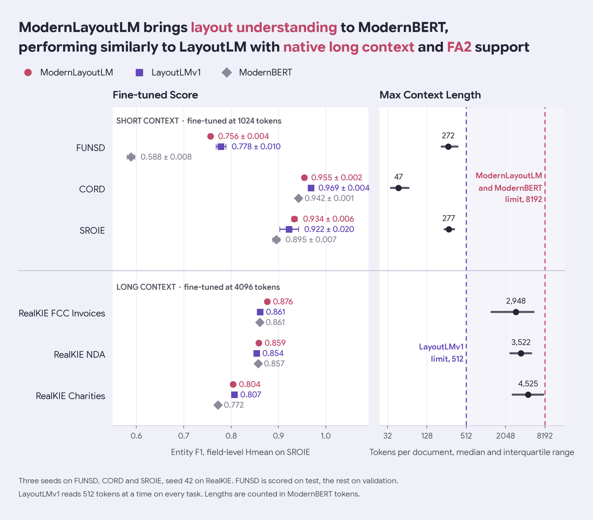
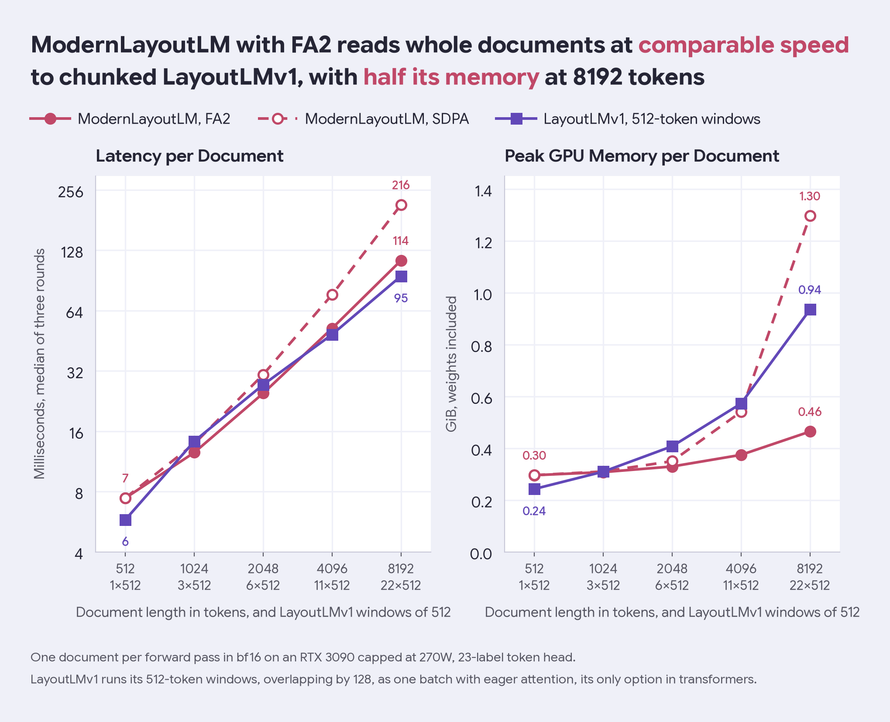

# ModernLayoutLM



ModernLayoutLM is an attempt to produce a long-context (like ModernBERT) bidirectional encoder that incorporates layout information into its training (like LayoutLM). ModernLayoutLM uses the same recipe as Xu et al. (2020) in the creation of LayoutLMv1, where the major difference is swapping BERT with ModernBERT (Warner et al., 2024).

## Intended use

The model is a pre-trained checkpoint that can be fine-tuned to layout understanding tasks, like named entity recognition or document classification.

```python
from transformers import AutoModelForMaskedLM, AutoProcessor

path = "kkuroma/ModernLayoutLM"
model = AutoModelForMaskedLM.from_pretrained(path, trust_remote_code=True)
processor = AutoProcessor.from_pretrained(path, trust_remote_code=True)

batch = processor(words=["Total", "42.00"], boxes=[[10, 10, 60, 20], [70, 10, 140, 20]], max_length=512, return_tensors="pt")
model(**batch)
```

- `bbox` holds one `(x0, y0, x1, y1)` per word, with the origin at the top left of the page.
- Coordinates are normalized to `[0, 1000]` by the page width and height, not given in pixels.
- Every subword of a word takes the word's box, which the bundled processor handles.
- `padding` defaults to `max_length`, which without an explicit length is the model's own 8192.
- `bbox=None` skips the layout sum and the model runs as plain ModernBERT, while all-zero boxes put every word at the origin.
- Attention defaults to SDPA; `attn_implementation="flash_attention_2"` with `flash-attn` installed is faster and lighter on long documents, see Inference cost.

## Training data

ModernLayoutLM is pretrained on about 11M pages of English business and scientific documents, each read once, in two stages.

| stage | source | pages |
|---|---|---|
| 1 | Industry Documents Library (IDL), words and boxes from Amazon Textract | 1.5M |
| 1 | PubTables-1M | 461k |
| 1 | PDFA (`pixparse/pdfa-eng-wds`) | 160k |
| 1 | DocLayNet v1.2 | 68k |
| 2 | IDL, from the shards stage 1 never read | 8.8M |

Pages carrying a Bates number from the FUNSD or RVL-CDIP evaluation splits are dropped from both stages, since IDL and those benchmarks share IIT-CDIP.

## Training procedure

ModernLayoutLM is pretrained with the masked visual-language model of LayoutLMv1 (Xu et al., 2020). Four 2D position embedding tables, where `x0` and `x1` share table X and `y0` and `y1` share table Y, are summed into the token embeddings before the embedding LayerNorm. Text is masked and boxes are left intact, so recovering a masked token rewards reading its position on the page. The four tables start at zero, so the model starts numerically identical to ModernBERT. The number of iterations and the duration are set by hardware limitations, as every step ran on a single RTX 3090.

| setting | value |
|---|---|
| sequence length | 512 tokens, packed |
| masking rate | 30%, following ModernBERT |
| batch | 64 sequences per optimizer step |
| learning rate | 5e-5 for the backbone, 1e-3 for the four layout tables |
| schedule | 5% warmup, weight decay 0.01, one epoch per stage |
| precision | fp32 master weights under bf16 autocast |
| steps | 29,899 in stage 1, 115,009 in stage 2 |

| stage | data unpacking | training |
|---|---|---|
| 1 | not recorded | 10.1 hours at 52 sequences per second |
| 2 | 0.9 hours to unpack the IDL shards, 2.3 hours to tokenize and pack | 17.9 hours at 114 sequences per second |

## Evaluation

### FUNSD

- Source: Jaume et al. (2019), read from `nielsr/funsd`
- Released: 2019
- Size: 199 scanned forms, 149 train and 50 test
- Task: entity labeling over header, question and answer, as 7 BIO labels

### CORD

- Source: Park et al. (2019), read from `naver-clova-ix/cord-v2`
- Released: 2019
- Size: 1,000 Indonesian receipts, 800 train, 100 validation and 100 test
- Task: receipt field labeling over 29 categories such as menu name, price and total, as 59 BIO labels

### SROIE

- Source: the ICDAR 2019 Competition on Scanned Receipt OCR and Information Extraction (Huang et al., 2019), read from `Ssunbell/SROIE_layoutlmv2_sequence`
- Released: 2019
- Size: 973 receipts, 594 train, 32 validation and 347 test
- Task: key information extraction over company, date, address and total, as 9 BIO labels

### RealKIE

- Source: Townsend et al. (2024), the FCC Invoices, NDA and Charities sets, read from the Zenodo release with its own OCR
- Released: 2024
- Size: long multi-page documents, 38% to 55% of them past 4096 tokens
- Task: key information extraction labeled as character spans over the OCR text

| set | train, validation and test documents | fields | BIO labels | median tokens |
|---|---|---|---|---|
| FCC Invoices | 221, 75 and 74 | 11 | 23 | 2,948 |
| NDA | 248, 93 and 98 | 3 | 7 | 3,522 |
| Charities | 322, 108 and 108 | 28 | 57 | 4,525 |

### Results

Each column is one model fine-tuned on identical data.

- **ModernLayoutLM**: this model, fine-tuned with boxes.
- **LayoutLMv1**: `microsoft/layoutlm-base-uncased`, fine-tuned with boxes.
- **ModernLayoutLM (no-pretrain)**: the same architecture fine-tuned with boxes straight from ModernBERT, skipping the layout pretraining.
- **ModernLayoutLM (no-bbox)**: this model fine-tuned with every box at the origin.
- **ModernBERT**: `answerdotai/ModernBERT-base` fine-tuned on text alone.

| setting | value |
|---|---|
| metric | entity F1, and field-level Hmean per ICDAR task 3 on SROIE |
| seeds | mean ± standard deviation over three seeds, one seed on RealKIE |
| split | FUNSD on test as it has no validation split, the rest on validation |
| learning rate | 3e-4, chosen on FUNSD test, and 5e-5 for LayoutLMv1 as in its paper |
| epochs | 30, 10 on RealKIE |
| window | 1024 tokens, 4096 on RealKIE, 512 for LayoutLMv1 as its positions cap there |
| long documents | chunks are stitched back into one document before scoring |

| dataset | ModernLayoutLM | LayoutLMv1 | ModernLayoutLM (no-pretrain) | ModernLayoutLM (no-bbox) | ModernBERT |
|---|---|---|---|---|---|
| FUNSD | 0.7565 ± 0.0037 | 0.7785 ± 0.0104 | 0.5939 ± 0.0205 | 0.3000 ± 0.0247 | 0.5884 ± 0.0082 |
| CORD | 0.9546 ± 0.0023 | 0.9685 ± 0.0037 | 0.9462 ± 0.0050 | 0.9312 ± 0.0042 | 0.9424 ± 0.0006 |
| SROIE | 0.9337 ± 0.0060 | 0.9223 ± 0.0199 | 0.8883 ± 0.0121 | 0.8411 ± 0.0189 | 0.8955 ± 0.0072 |
| RealKIE FCC | 0.8761 | 0.8613 | 0.8569 | 0.7178 | 0.8607 |
| RealKIE NDA | 0.8586 | 0.8539 | 0.8503 | 0.5735 | 0.8571 |
| RealKIE Charities | 0.8043 | 0.8071 | 0.7679 | 0.3740 | 0.7725 |

ModernLayoutLM performs comparably to LayoutLMv1, but natively supports long context.

### Inference cost



| setting | value |
|---|---|
| input | one document per forward pass, bf16, 23-label token head |
| hardware | RTX 3090 capped at 270W |
| timing | median of three rounds of 30 passes, the model order alternating between rounds |
| memory | peak allocated, weights included |
| LayoutLMv1 | 512-token windows overlapping by 128, run as one batch with eager attention, its only option in transformers |

| tokens | LayoutLMv1 windows | LayoutLMv1 ms | ModernLayoutLM SDPA ms | ModernLayoutLM FA2 ms | LayoutLMv1 GiB | ModernLayoutLM SDPA GiB | ModernLayoutLM FA2 GiB |
|---|---|---|---|---|---|---|---|
| 512 | 1 | 5.8 | 7.4 | 7.4 | 0.24 | 0.30 | 0.30 |
| 1024 | 3 | 14.3 | 13.9 | 12.5 | 0.31 | 0.31 | 0.31 |
| 2048 | 6 | 27.3 | 30.7 | 24.8 | 0.41 | 0.35 | 0.33 |
| 4096 | 11 | 48.6 | 76.9 | 52.2 | 0.57 | 0.54 | 0.37 |
| 8192 | 22 | 95.1 | 215.7 | 113.8 | 0.94 | 1.30 | 0.46 |

## Citation

Xu, Y., Li, M., Cui, L., Huang, S., Wei, F., & Zhou, M. (2020). LayoutLM: Pre-training of Text and Layout for Document Image Understanding. In *Proceedings of the 26th ACM SIGKDD International Conference on Knowledge Discovery & Data Mining* (pp. 1192-1200). https://doi.org/10.1145/3394486.3403172

Warner, B., Chaffin, A., Clavié, B., Weller, O., Hallström, O., Taghadouini, S., Gallagher, A., Biswas, R., Ladhak, F., Aarsen, T., Cooper, N., Adams, G., Howard, J., & Poli, I. (2024). Smarter, Better, Faster, Longer: A Modern Bidirectional Encoder for Fast, Memory Efficient, and Long Context Finetuning and Inference. Preprint.

```bibtex
@inproceedings{xu2020layoutlm,
  title={LayoutLM: Pre-training of Text and Layout for Document Image Understanding},
  author={Xu, Yiheng and Li, Minghao and Cui, Lei and Huang, Shaohan and Wei, Furu and Zhou, Ming},
  booktitle={Proceedings of the 26th ACM SIGKDD International Conference on Knowledge Discovery \& Data Mining},
  pages={1192--1200},
  year={2020},
  publisher={ACM},
  doi={10.1145/3394486.3403172}
}

@misc{warner2024smarterbetterfasterlonger,
  title={Smarter, Better, Faster, Longer: A Modern Bidirectional Encoder for Fast, Memory Efficient, and Long Context Finetuning and Inference},
  author={Benjamin Warner and Antoine Chaffin and Benjamin Clavi{\'e} and Orion Weller and Oskar Hallstr{\"o}m and Said Taghadouini and Alexis Gallagher and Raja Biswas and Faisal Ladhak and Tom Aarsen and Nathan Cooper and Griffin Adams and Jeremy Howard and Iacopo Poli},
  year={2024}
}
```

## License

Apache 2.0, the license ModernBERT is released under, see `LICENSE`.

## Reproducing

### Layout

```
data -> /mnt/Vault-Storage/research/layout-datasets   symlink, gitignored
  raw/          datasets exactly as downloaded
  processed/    canonical parquet, our schema
  checkpoints/  training checkpoints, see checkpoints/CLEANUP-2026-08-19.md
  exports/      finished HF-format model directories
models/         gitignored: the pulled upstream backbones, nothing else
packed/         gitignored: tokenized pretraining packs, on local disk for random reads
src/            importable code, four layered stages
scripts/        runnable entrypoints, one per job
tests/          fast by construction
notebooks/      results/ holds the tables scripts/evaluate.py writes
config.toml     every path and hyperparameter
notes.md        facts found along the way, newest first
performance.png the figure at the top of this README
resource-usage.png the figure under Inference cost
```

See `src/README.md` and `scripts/README.md` for the module trees.

### Setup

`direnv` plus the nix flake pin the interpreter and tools, `uv` owns the packages.

```sh
uv sync
```

The flake also exports `HF_HOME` into `data/raw/hf-cache`, so hub weights and the arrow caches `datasets` builds land on the vault rather than filling the SSD under `~/.cache/huggingface`.

PaddleOCR is intentionally not a dependency: `paddlepaddle` ships no cp314 wheels, and no dataset in the pipeline needs OCR.
See `src/data/README.md` if that ever changes.

### Running it

```sh
# 1. pull the backbone and the small downstream datasets
uv run python scripts/build_datasets.py --group downstream

# 2. the layout-MLM corpus, fingerprints first so benchmark pages drop out of IDL
uv run python scripts/build_fingerprints.py
uv run python scripts/build_datasets.py --group pretrain --workers 3

# 3. layout-aware MLM, then the fine-tuning matrix
uv run python scripts/pretrain.py
uv run python scripts/finetune.py --dataset funsd --seed 42 43 44

# 4. score everything, export, publish
uv run python scripts/evaluate.py
uv run python scripts/export.py --checkpoint data/checkpoints/fp32
uv run python scripts/export.py --push owner/name
```

`scripts/export.py` writes the export with this README up to Reproducing as its card, then reloads it in a cold process and requires bit-identical logits before it exits 0.
The per-metric tables are in `notebooks/results/results.md`.
